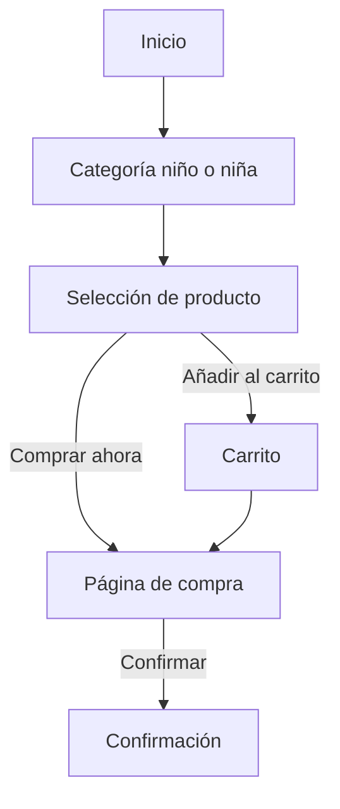
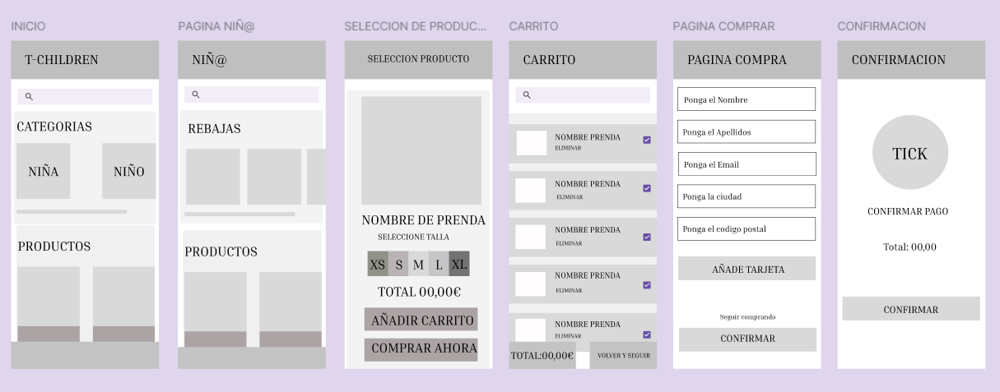

# Documentación de la interfaz — T-Children

## 1. Justificación del diseño

### 1.1 Importancia del diseño centrado en el usuario
El diseño de la aplicación está pensado principalmente para madres, padres, abuelos y personas que compran ropa infantil como regalo. Son personas que normalmente tienen poco tiempo y pueden tener dudas a la hora de elegir una talla.

Por eso, la aplicación debe ser intuitiva y fácil de usar desde el móvil. La idea es que el usuario pueda encontrar la ropa que busca rápidamente, consultar las tallas y realizar una compra sin complicaciones.
### 1.2 Objetivos y metas del proyecto
Los principales objetivos de la aplicación son:

1. Conseguir que el usuario pueda completar una compra en menos de minutos.

2. Conseguir que el usuario pueda encontrar un producto utilizando los filtros en menos de  segundos.

3. Conseguir que al menos 9 de cada 10 usuarios puedan encontrar y utilizar correctamente la guía de tallas.
### 1.3 Beneficios esperados
Para el usuario, la aplicación permitirá encontrar ropa infantil de una forma más rápida y sencilla. También tendrá más facilidad para elegir la talla gracias a la guía de tallas.

Para la tienda, la aplicación puede facilitar las compras desde el móvil y hacer que el proceso de compra sea más cómodo para los clientes.
## 2. Investigación y análisis de usuarios

### 2.1 Datos demográficos y segmentación
El público principal de la aplicación son personas que compran ropa y calzado infantil para niños de 0 a 14 años.

Dentro de este grupo encontramos principalmente madres, padres, abuelos y personas que compran regalos. Son usuarios que pueden utilizar la aplicación desde el móvil y que buscan realizar la compra de forma rápida.

También se tiene en cuenta que algunos usuarios pueden tener dudas con las tallas, por lo que la aplicación debe facilitar esta información.
### 2.2 Personas
#### Persona 1: Jose Miguel, 35 años

Josemi es un padre de dos niños y compra ropa infantil habitualmente. Tiene poco tiempo libre y suele hacer las compras desde el móvil.

**Objetivos:**

* Encontrar un regalo fácilmente.
* Saber qué talla debe comprar.
* Tener un proceso de compra sencillo.

**Frustraciones:**

* No saber qué talla elegir.
* Encontrar demasiadas opciones y no saber cuál escoger.
* Tener dificultades para encontrar algunas funciones.

#### Persona 2: Mari Carmen, 75 años

Mari Carmen es una abuela y utiliza la aplicación para comprar regalos de ropa para sus nietos. No compra ropa infantil habitualmente y puede tener más dudas a la hora de elegir una talla.
**Objetivos:**

* Encontrar ropa rápidamente.
* Saber qué tallas hay disponibles.
* Poder comprar sin perder mucho tiempo.

**Frustraciones:**

* Tardar mucho en encontrar una prenda.
* No saber qué talla elegir.
* Tener que pasar por demasiados pasos para comprar.
### 2.3 Análisis de la competencia
**Zara**
Que hace bien: Tiene muchas categorías y permite filtrar los productos.
Que hace mal: Utilizar categorías y filtros claros.
Que me llevo: Utilizar categorías y filtros claros.
**HyM**
Que cosas hace bien: Tiene una navegación sencilla y diferentes categorías de ropa infantil.
Que cosas hace mal: Organizar bien los productos y facilitar la búsqueda.
Que me llevo: Organizar bien los productos y facilitar la búsqueda.
**Primark**
Que cosas hace bien:Está muy centrada en ropa para toda la familia y permite buscar por categorías.
Que cosas hace mal:Puede resultar algo cargada por la cantidad de productos y opciones.
Que llevo: Mostrar la información importante de forma clara y sencilla.
### 2.4 Insights y hallazgos clave
1. Los usuarios tienen dudas con las tallas → añadir una guía de tallas dentro del detalle del producto.
2. Los usuarios tienen poco tiempo para comprar  hacer que la navegación y el proceso de compra sean rápidos y sencillos.
3. Los usuarios compran principalmente desde el móvil utilizar botones grandes y fáciles de pulsar.
4. Los usuarios pueden tener problemas para encontrar un producto añadir un buscador y filtros por edad, talla, color y precio.
## 3. Diseño de la interfaz

### 3.1 Mapa de navegación

La aplicación MiniStyle permite acceder desde la pantalla de inicio a las categorías de ropa infantil. Después, el usuario puede seleccionar un producto, elegir una talla, añadirlo al carrito y continuar con la compra hasta llegar a la confirmación.

### 3.2 Wireframes

Se han realizado wireframes de las pantallas principales de MiniStyle para organizar los elementos antes de crear el diseño definitivo.

- **Inicio:** muestra las categorías infantiles y una selección de productos.
- **Página de niño o niña:** permite consultar las prendas de la categoría elegida.
- **Selección de producto:** muestra la prenda, las tallas disponibles y las opciones para añadirla al carrito o comprarla.
- **Carrito:** presenta los productos seleccionados, permite eliminarlos y muestra el importe total.
- **Página de compra:** contiene los campos para introducir los datos necesarios para continuar con el pedido.
- **Confirmación:** muestra el resultado final del proceso de compra.
git remote -v
Los wireframes sirven como base para desarrollar el prototipo de alta fidelidad utilizando Material Design 3.

### 3.3 Guía de estilo Material Design 3

3.3. Guía de estilo Material Design 3

### 3.3. Guía de estilo Material Design 3

La aplicación **MiniStyle** utiliza un diseño colorido y sencillo, pensado para una tienda de ropa infantil. Todas las pantallas mantienen un estilo parecido para que la aplicación sea fácil de entender y utilizar.

**Colores utilizados**

- **Marrón claro (`#AD8060`):** se utiliza en los encabezados de las pantallas.
- **Azul (`#0787F9`):** se utiliza en botones y elementos destacados.
- **Amarillo claro (`#FFE6A3`):** se utiliza en los fondos de las secciones de categorías, rebajas, productos y algunos botones.
- **Turquesa claro (`#A8F0E8`):** se utiliza en botones y elementos de la pantalla de selección de producto.
- **Verde claro (`#A5F2C0`):** se utiliza como fondo de la pantalla de selección de producto.
- **Rosa muy claro (`#FFF8F6`):** se utiliza como fondo general de la aplicación.
- **Blanco (`#FFFFFF`):** se utiliza como fondo de las imágenes de los productos y de algunas pantallas.

**Tipografía**

Se utilizan letras sencillas para mostrar los títulos, los nombres de los productos, los precios y los textos de los botones. Los títulos de las secciones aparecen más destacados que los textos secundarios.

**Organización de las pantallas**

La aplicación cuenta con las siguientes pantallas:

- **Inicio:** muestra las categorías de ropa y una selección de productos.
- **Página de niño o niña:** muestra las rebajas y los productos disponibles.
- **Selección de producto:** muestra la imagen de la prenda, las tallas, el precio y las opciones para añadir al carrito o comprar.
- **Carrito:** muestra los productos seleccionados y permite revisar la compra.
- **Página de compra:** contiene los campos para introducir los datos necesarios para realizar el pedido.
- **Confirmación:** muestra un símbolo de confirmación y permite confirmar el pedido.
- **Favoritos:** permitirá consultar los productos guardados, manteniendo los mismos colores y el estilo visual del resto de la aplicación.

**Botones y elementos**

Los botones utilizan principalmente azul, amarillo y turquesa para destacar las acciones. Las tallas se muestran en una fila de botones y las imágenes ayudan a identificar rápidamente las prendas. También se utiliza una barra de búsqueda para facilitar la búsqueda de productos.

**Imágenes**

Se utilizan fotografías de ropa infantil y de niños y niñas para mostrar las categorías y los productos de la tienda. Las imágenes tienen un papel importante porque permiten al usuario ver las prendas antes de seleccionarlas.

**Distribución y facilidad de uso**

Las pantallas mantienen una distribución parecida, con encabezados, secciones y botones fáciles de localizar. De esta forma, el usuario puede navegar por la tienda, elegir productos, revisar el carrito y completar la compra de una manera sencilla.

### 3.4 Prototipo de alta fidelidad

El prototipo de MiniStyle se desarrollará en Figma a partir de los wireframes existentes. Se mantendrá el recorrido desde la selección de productos hasta la confirmación de compra.

En la versión final se incorporarán componentes de Material Design 3, componentes propios con variantes y Auto Layout, navegación entre pantallas, una ventana inferior superpuesta, animaciones de transición, un estado de error y pantallas en modo oscuro.

El prototipo deberá incluir al menos siete pantallas de 360 × 800 px y la palabra del día indicada en clase.
## 5. Entrega y documentación final

### 5.1 Justificación del diseño propuesto

El diseño de MiniStyle está pensado para que comprar ropa infantil sea sencillo y cómodo. Se utilizan colores alegres, imágenes de prendas y botones fáciles de identificar. Las pantallas mantienen una distribución parecida para que el usuario pueda encontrar los productos, seleccionar una talla, revisar el carrito y completar la compra sin complicaciones.

También se incluye una pantalla de favoritos para guardar prendas y consultarlas más tarde. El diseño busca que la aplicación sea clara, visual y fácil de utilizar.

### 5.2 Recomendaciones y pasos a seguir

Como mejoras futuras, se recomienda probar la aplicación con más usuarios para conocer su opinión y detectar posibles problemas. También se podrían añadir más filtros para buscar ropa por edad, talla, precio y categoría.

Otros pasos recomendados son comprobar que todos los botones funcionan correctamente, revisar la legibilidad de los textos y verificar que los colores tengan suficiente contraste. Por último, se deben mantener actualizados el prototipo de Figma, las capturas y la documentación del proyecto.

## 6. Referencias bibliográficas  
Palabra del dia: **29**
